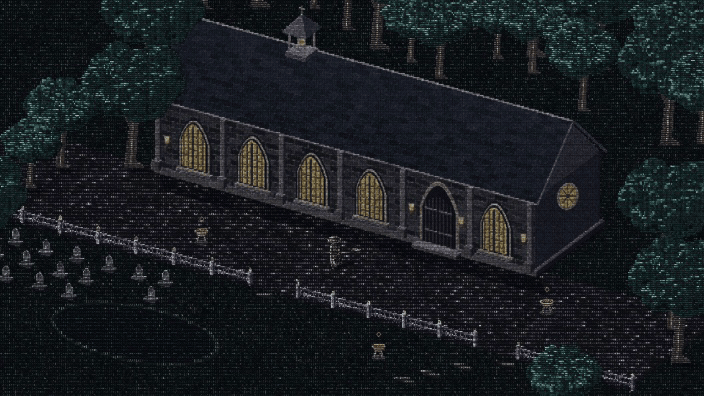
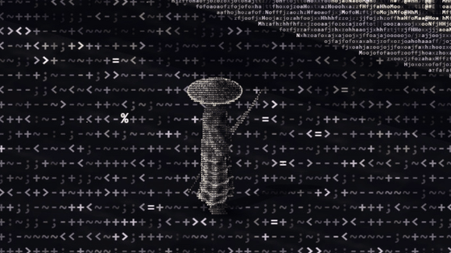
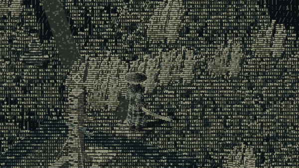
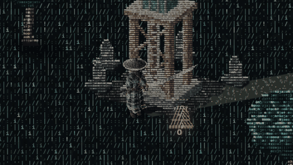

# Cinder Vigil — The Ember Swordsman

A lone swordsman keeps watch at Reedwater Ferry. Three fires have gone dark, and the last ferry is caught on the shoal. Relight the fires, answer the pilot’s call and guide the kiln workers home before dawn.

A **cinder** is a piece of fuel still glowing after a fire burns down. A **vigil** is a watch kept through the night. *Cinder Vigil* names the watch. *The Ember Swordsman* names the keeper you play.

## Play

[Play Cinder Vigil on GitHub Pages](https://tharunbabu-05.github.io/cinder-vigil-the-ember-swordsman/).

For offline play, download and extract the repository ZIP or clone the repository. Open **index.html** in a modern browser. The game, score, and field guide run locally. On Windows, launch it from the project folder with:

```powershell
Start-Process .\index.html
```

## AI disclosure

Tharun directed the game’s concept, gameplay and visual style. He used OpenAI Codex to write and iterate on the game and website code, including the renderer that draws the ASCII art from geometry in the browser. The recorded sound effects are credited below.

## Two ways to use the katana

- **Crescent slash.** Aim at a shade and left-click once. The keeper raises the blade, swings through the target, and returns to guard.
- **Crossing lunge.** Click a second time within 360 milliseconds. The opening slash finishes, then the keeper steps forward into a rising return cut and a descending finish. The action display shows when the follow-up is queued.

## In motion

These GIFs were captured from the playable game. Open **Field guide** in the header to inspect each move with its controls.

| The keeper up close | Walking and turning |
| --- | --- |
|  |  |
| **Reedwater Ferry** | **Shadow step** |
|  |  |
| **Crescent slash · one click** | **Crossing lunge · two clicks** |
|  |  |

## Controls

| Action | Desktop | Touch |
| --- | --- | --- |
| Walk | WASD or arrow keys | Direction pad |
| Jump | J, with a movement direction to carry the jump | Hold the pad and tap Jump |
| Open the river atlas | G or Atlas | Atlas |
| Crescent slash | Left-click to aim, or Space to strike in the facing direction | Tap Strike |
| Crossing lunge | Double-click, or press Space twice | Double-tap Strike |
| Dash | Shift with a direction, or Shift to dash forward | Dash with the pad, or Dash alone |
| Use a fire, landmark or quest item | E near the target | Use |
| Camera | C to cycle, mouse wheel or + / − to fine-tune | Zoom |
| Music and sound | M or the sound button | Sound button |
| Pause and resume | Esc or the pause button | Pause / Resume |
| Browse recorded moves | Field guide | Field guide |

## The night watch

Each watchfire wakes a shade. Follow the bearing below the objective through the court openings and over the timber footbridges. When all three fires burn, return to the bronze gong in the gatehouse. Ringing it restores vitality and begins the second chapter.

### The pilots’ survey

Nao used to make paper charts for the ferry crews. Her unfinished copy lies on the survey desk west of the gatehouse court. Open **Atlas** with **G** to see your position, bridge crossings, ferry duties and survey stations. Select a station and choose **Track on compass**. The roads are open from the start, and you can visit the stations in any order.

| Station | What you can discover |
| --- | --- |
| Mulberry Mill | Follow the cedar cutters’ track to the millrace and take a rubbing of the heron watermark. |
| Heron Fen | Cross the western timber bridge and jump the broken boardwalk. The flood pole on the island holds the pilots’ water marks. |
| Nine-Reed Observatory | Follow the shale road south of the kilns and sight the star in the brass instrument that once guided the ferry through fog. |

Bring the three records back to the survey desk and bind the chart. **Travel here** then appears in the atlas when you stand at one station and select another. Off the marked roads, the reedcutters’ blind and the shepherds’ fold offer stories and restore vitality on your first visit to each. Their locations appear on your chart when you find them.



Press **J** to jump in place or hold a direction to clear low courtyard rails, marsh gaps or the bell warden’s ground wave. A short landing over the marsh returns you to firm ground. After the ferry arrives, choose **Keep exploring** to finish your survey. Survey notes last for the current watch, including checkpoint retries.

### The last ferry

Salvage a brass crank pin from the wreck at **Salt Quay**. Carry it over the eastern footbridge to open the **East Sluice**, then follow the shell road to **Beacon Headland**. Call the bell warden, survive its toll and light the pilot’s beacon. Completed duties become checkpoints for the current watch. Refreshing the page starts a fresh watch.

The pilot also left a sealed letter in the gatehouse court. Take it to the **pilots’ shrine** on the shell road to restore vitality and gain a fourth heart. Open **Field guide** and choose **Follow letter** to put the errand on the compass. You can switch back to your main duty at any time.

| Enemy | What to watch for |
| --- | --- |
| Watchfire shade | Closes steadily after a fire is lit. One cut disperses it. |
| Reed stalker | Marks its rush in ochre. Sidestep the line and strike during its recovery. |
| Lantern moth | Holds away from the blade and aims a blue spark. Cross its line of fire to close the distance. |
| Bell warden | Sends a ring out from its feet. Dash through the wave and land cuts between tolls. |



The keeper is rendered from a moving mesh into a depth buffer of ASCII characters. Indigo robe panels carry wave-pattern embroidery, stitched cuffs and a braided belt. The lacquered scabbard hangs below the cord. Both hands come together during a cut. Hits follow the path of the blade, and its edge leaves a short ribbon through the air.

## Audio

The first gameplay input starts the original score. Left and right footfalls use separate recordings, with three variations per foot on each surface. Each blade pass and the dash has its own air sound. Use **M** to mute the mix.

- Step recordings by Fantozzi, edited and level-matched for the game. [Fantozzi's Footsteps (CC0)](https://opengameart.org/content/fantozzis-footsteps-grasssand-stone)
- Bamboo swishes recorded by qubodup, edited for the three cuts and layered for the dash. [Swish (CC0)](https://opengameart.org/content/swish-bamboo-stick-weapon-swhoshes)

## Player count

The hosted game displays a shared total of browsers that have started playing since the counter was added. Moving, jumping, attacking, dashing or interacting counts as play. A flag stored in the browser keeps repeat plays and refreshes from raising the total. Private windows, separate devices and cleared site data can count separately. The browser sends the game’s counter key to [Abacus](https://v2.jasoncameron.dev/abacus/) to read or increment the total. The game keeps the flag on the device.
