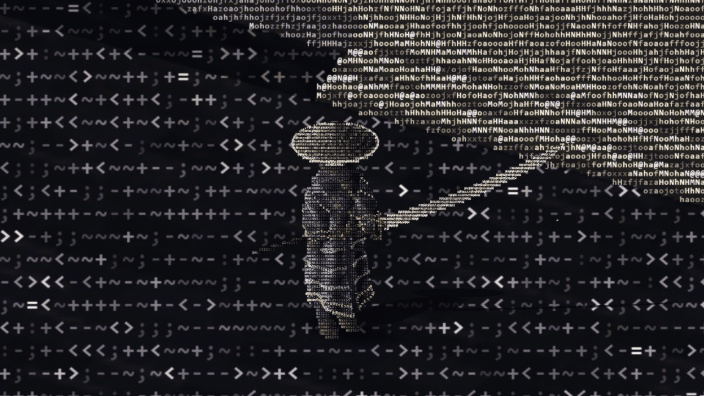

# Cinder Vigil — The Ember Swordsman

A lone swordsman keeps watch at Reedwater Ferry. Three fires have gone dark. Leave the lantern gatehouse, kindle the fires in the cedar grove, dyers' market and kiln terrace, then return to sound the hanging gong.

A **cinder** is a piece of fuel still glowing after a fire burns down. A **vigil** is a watch kept through the night. *Cinder Vigil* names the watch. *The Ember Swordsman* names the keeper you play.

## Play

[Play Cinder Vigil on GitHub Pages](https://tharunbabu-05.github.io/cinder-vigil-the-ember-swordsman/).

For offline play, download and extract the repository ZIP or clone the repository. Open **index.html** in a modern browser. The game, score, and field guide run locally. On Windows, launch it from the project folder with:

```powershell
Start-Process .\index.html
```

## Two ways to use the katana

- **Crescent slash.** Aim at a shade and left-click once. The keeper raises the blade, swings through the target, and returns to guard.
- **Crossing lunge.** Click a second time within 360 milliseconds. The opening slash finishes, then the keeper steps forward into a rising return cut and a descending finish. The action display shows when the follow-up is queued.

## In motion

These GIFs were captured from the playable game. Open **Field guide** in the header to inspect each move with its controls.

| The keeper up close | Walking and turning |
| --- | --- |
|  |  |
| **Reedwater Ferry** | **Shadow step** |
|  |  |
| **Crescent slash · one click** | **Crossing lunge · two clicks** |
|  |  |

## Controls

| Action | Desktop | Touch |
| --- | --- | --- |
| Walk | WASD or arrow keys | Direction pad |
| Crescent slash | Left-click to aim, or Space to strike in the facing direction | Tap Strike |
| Crossing lunge | Double-click, or press Space twice | Double-tap Strike |
| Dash | Shift with a direction, or Shift to dash forward | Dash with the pad, or Dash alone |
| Kindle a fire or sound the gong | E near the target | Use |
| Camera | C to cycle, mouse wheel or + / − to fine-tune | Zoom |
| Music and sound | M or the sound button | Sound button |
| Pause and resume | Esc or the pause button | Pause / Resume |
| Browse recorded moves | Field guide | Field guide |

## The night watch

Each watchfire wakes a shade. Follow the bearing below the objective, and watch the dash meter for your next burst. The river separates the market and grove from the kiln terrace. Cross at either timber footbridge. When all three fires burn, return to the bronze gong in the ferry gatehouse.

The keeper is rendered from a moving mesh into a depth buffer of ASCII characters. Indigo robe panels carry wave-pattern embroidery, stitched cuffs and a braided belt. The lacquered scabbard hangs below the cord. Both hands come together during a cut. Hits follow the path of the blade, and its edge leaves a short ribbon through the air.

## Audio

The first gameplay input starts the original score. Left and right footfalls use separate recordings, with three variations per foot on each surface. Each blade pass and the dash has its own air sound. Use **M** to mute the mix.

- Step recordings by Fantozzi, edited and level-matched for the game. [Fantozzi's Footsteps (CC0)](https://opengameart.org/content/fantozzis-footsteps-grasssand-stone)
- Bamboo swishes recorded by qubodup, edited for the three cuts and layered for the dash. [Swish (CC0)](https://opengameart.org/content/swish-bamboo-stick-weapon-swhoshes)

## Player count

The hosted game displays a shared total of browsers that have started playing since the counter was added. Moving, attacking, dashing or interacting counts as play. A flag stored in the browser keeps repeat plays and refreshes from raising the total. Private windows, separate devices and cleared site data can count separately. The browser sends the game’s counter key to [Abacus](https://v2.jasoncameron.dev/abacus/) to read or increment the total. The game keeps the flag on the device.
