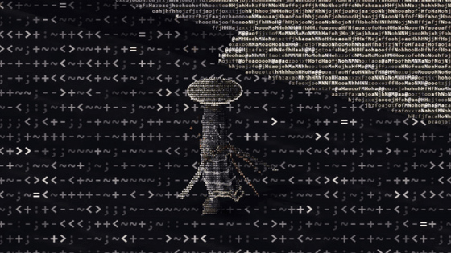
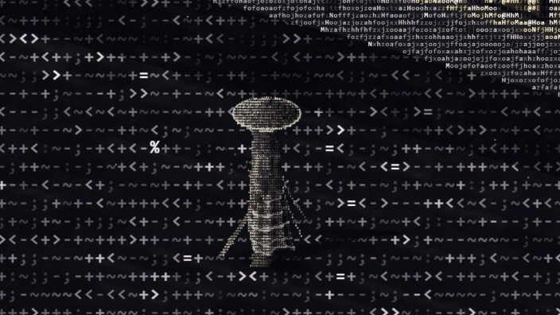

# Cinder Vigil — The Ember Swordsman

A lone swordsman keeps watch at Ashmere Chapel. Three watchfires have gone dark. Cross the courtyard, kindle them, and survive long enough to ring the bell.

A **cinder** is a piece of fuel still glowing after a fire burns down. A **vigil** is a watch kept through the night. *Cinder Vigil* names the watch. *The Ember Swordsman* names the keeper you play.

## Play

Download and extract the repository ZIP or clone the repository. Open **index.html** in a modern browser. The game, score, and field guide run locally. On Windows, launch it from the project folder with:

```powershell
Start-Process .\index.html
```

## Two ways to use the katana

- **Crescent slash.** Aim at a shade and left-click once. The keeper raises the blade, swings through the target, and returns to guard.
- **Crossing lunge.** Click a second time within 360 milliseconds. The opening slash finishes, then the keeper steps forward into a rising return cut and a descending finish. The action display shows when the follow-up is queued.

## In motion

These GIFs were captured from the playable game. Open **Field guide** in the header to inspect each move with its controls.

| The keeper up close | Walking and turning |
| --- | --- |
|  |  |
| **Chapel grounds** | **Shadow step** |
|  |  |
| **Crescent slash · one click** | **Crossing lunge · two clicks** |
|  |  |

## Controls

| Action | Desktop | Touch |
| --- | --- | --- |
| Walk | WASD or arrow keys | Direction pad |
| Crescent slash | Left-click to aim, or Space to strike in the facing direction | Tap Strike |
| Crossing lunge | Double-click, or press Space twice | Double-tap Strike |
| Dash | Shift with a direction, or Shift to dash forward | Dash with the pad, or Dash alone |
| Kindle a fire or ring the bell | E near the target | Use |
| Camera | C to cycle, mouse wheel or + / − to fine-tune | Zoom |
| Music and sound | M or the sound button | Sound button |
| Pause and resume | Esc or the pause button | Pause / Resume |
| Browse recorded moves | Field guide | Field guide |

## The night watch

Each lit watchfire wakes a shade. Watch your three vitality marks and the dash recovery meter. Use the gaps in the fence to reach the garden. Once all three fires burn, return to the chapel door and ring the bell.

The keeper is rendered from a moving mesh into a depth buffer of ASCII characters. The brim hides the face, the katana passes around the body, and stitches follow the robe as it moves. The chapel uses different glyph patterns for slate, stone, foliage and light. The first gameplay input starts an original looping score. Footsteps follow the keeper’s stride, with a sharper tap on paving and softer scuffs in the garden.

The chapel setting and wide-hatted figure were inspired by the ASCII game clip supplied as a visual reference. The game code, artwork, score, and gameplay recordings in this repository were created for Cinder Vigil.
